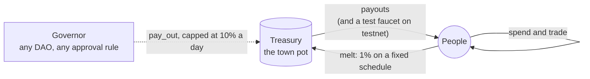

<div align="center">


# Wörgl

**Money with a shelf life.**

A memecoin on NEAR where every balance melts on a fixed schedule,<br>
and the melt goes to a treasury that a DAO pays out again.

[](https://testnet.nearblocks.io/address/worgl-token.testnet)
[](https://nearhackathon.com)
[](LICENSE)

[**Live demo**](https://worgl.vercel.app) ·
[Demo video](https://x.com/Devendra_116/status/2121648093951295983) ·
[Token on NearBlocks](https://testnet.nearblocks.io/address/worgl-token.testnet) ·
[DAO on NearBlocks](https://testnet.nearblocks.io/address/devworgl-dao.sputnikv2.testnet)


</div>

---

## Summary

| | |
|---|---|
| **What** | A NEP-141 token whose balances lose a fixed percentage on a schedule. What melts returns to a treasury. A governor (a DAO) pays the treasury out again, under a daily limit the contract enforces. |
| **Status** | Working reference implementation on NEAR **testnet**. The coins have no value. Not audited. |
| **Live demo** | <https://worgl.vercel.app> |
| **Token contract** | [`worgl-token.testnet`](https://testnet.nearblocks.io/address/worgl-token.testnet) (Rust, source in [`contract/`](contract/)) |
| **Governor** | [`devworgl-dao.sputnikv2.testnet`](https://testnet.nearblocks.io/address/devworgl-dao.sputnikv2.testnet), an example Sputnik DAO. Any account or DAO can govern. |
| **Supply** | 1,000,000 WORGL, 18 decimals, fixed. The contract has no mint method. |
| **Melt rate** | Demo: **1% per hour**, so you can watch it. Intended real setting: **1% per month**. Set once at deployment. |
| **Payout limit** | 10% of the treasury per UTC day |
| **Tracks** | NEAR HACKATHON: Memecoins With Mechanics (`memecoins`) and Social Money (`social`) |

**Contents:** [The mechanic](#the-mechanic) · [Try it](#try-it) · [What NEAR does here](#what-near-does-here) · [How it works](#how-it-works) · [Check each claim](#check-each-claim) · [Reference](#reference) · [Develop and test](#develop-and-test) · [Limits](#limits-and-honest-notes) · [Hackathon disclosure](#hackathon-disclosure)

---

## The mechanic

**The problem.** Money that sits does nothing. DAO grants are an example: they are paid out, then sit in wallets while the treasury drains.

**The precedent.** In 1932 the Austrian town of Wörgl issued local money that lost 1% of its value each month. Holding it cost something, so people spent it. The national bank ended the experiment in 1933.

**This token.** The same loop on NEAR, with one addition: the melt is not lost. It returns to a shared treasury, and a DAO pays it out again.



The whole design is four rules:

1. **Fixed supply.** 1,000,000 coins exist from the start, all in the treasury. The contract has no mint method.
2. **One melt rate.** Every balance loses the same percentage on the same schedule. What melts returns to the treasury.
3. **One way out.** The treasury pays out only through `pay_out`, which only the governor can call.
4. **A hard daily limit.** Payouts are capped at 10% of the treasury per UTC day, whoever the governor is.

The governor decides who is paid. The contract decides how much can be paid. Two uses this fits: grant money that returns to the pot if unspent, and community or event credits that fade afterwards.

What 100 WORGL becomes if nobody touches it:

| After | Demo (1% per hour) | Real setting (1% per month) |
|---|---|---|
| 1 hour | 99.00 | 99.9986 |
| 1 day | 78.57 | 99.97 |
| 30 days | 0.07 | 99.00 |

---

## Try it

Each step is "do this, see that". Steps 1 to 3 need only a browser.

| # | Do | See |
|---|---|---|
| 1 | Open <https://worgl.vercel.app> | A banknote that starts at 100 and counts down in real time. Next to it: the live treasury, the coins people hold, and four checks your browser recomputes from the contract. |
| 2 | Open <https://worgl.vercel.app/try>, choose **Simulate it**, then press **Claim 100 test coins**, **Send 10 coins to Sam** and **Skip 1 day** | Your balance, Sam's balance and the town pot under "What your steps did". After the skip both balances are lower and the pot is higher. No wallet is used. |
| 3 | On the same page choose **My testnet wallet**, connect a NEAR testnet wallet and press **Claim 100 test coins** | A real transaction on `worgl-token.testnet`. Your balance shows 100 WORGL and starts to fall. |
| 4 | Run `scripts/verify-testnet.sh worgl-token.testnet` (needs Python 3, no keys) | Nine `PASS` lines, then `ALL CHECKS PASSED`. |
| 5 | Run `scripts/test.sh` (about 6 minutes, see [requirements](#run-every-test)) | `ALL TESTS PASSED`. |

Step 4 reads raw chain state at one block and recomputes everything itself. Its output on 14 November 2026:

```text
PASS  index matches independent rpow()
PASS  circulating = ceil(total_shares*index/RAY)
PASS  treasury + circulating = 1,000,000 coins  [1,000,000.000000]
PASS  ft_total_supply = 1,000,000 coins
PASS  ft_balance_of(token account) = treasury (same block: exact)
PASS  governor is set  [devworgl-dao.sputnikv2.testnet]
PASS  daily cap = 10% of day-start treasury  [cap 100,000.00, paid 10.00]
PASS  day_paid <= day_cap
PASS  day_remaining = cap - paid

ALL CHECKS PASSED
```

To run the website locally (Node 18+): `cd web && npm install && npm run dev`, then open <http://localhost:4321/>.

---

## What NEAR does here

- **The token is a NEAR contract.** It is written in Rust with `near-sdk` and follows NEP-141 (fungible token), NEP-145 (storage management) and NEP-148 (metadata).
- **The melt runs on NEAR's block time.** The contract works a balance out from `block_timestamp` whenever it is read. View calls are free, so a balance that changes every second costs nobody any gas.
- **A Sputnik DAO v2 is the governor.** A payout is a `FunctionCall` proposal that calls `pay_out` on the token. The example DAO has three council members and needs two approvals. Proposal 2 on [`devworgl-dao.sputnikv2.testnet`](https://testnet.nearblocks.io/address/devworgl-dao.sputnikv2.testnet) paid 10 WORGL to `worgluser.testnet` on 14 November 2026, approved by two members.
- **NEP-145 storage deposits register holders.** The faucet claim attaches about 0.00126 NEAR, and the contract refunds any excess.
- **The website reads the contract over NEAR RPC** and signs with a NEAR wallet through `@hot-labs/near-connect`. It has no backend.

---

## How it works

### Nothing runs every second

The contract stores only **shares** per account. One global **index** falls with time. A balance is worked out whenever somebody reads it:

```text
index       = factor ^ (whole seconds since start)      fixed point, RAY = 10^27, rounded down at every step
balance     = floor(shares × index ÷ RAY)
circulating = ceil(total_shares × index ÷ RAY)           what people hold, rounded up
treasury    = 1,000,000 coins − circulating              the contract's own account holds the rest
```

`factor` is the per-second melt factor, set once at deployment: `0.99^(1/3600)` for the demo and `0.99^(1/2592000)` for 1% per 30 days. The index depends only on the clock, so there is no job to run and nothing to keep in sync.

### Rounding always favours the treasury

- Balances round **down** and the total in circulation rounds **up**, so `treasury + circulating` is exactly 1,000,000 coins at every moment.
- A transfer takes `ceil(amount × RAY ÷ index)` shares from the sender and gives the receiver `floor(…)`. The leftover dust stays with the treasury.
- A balance melts every second, so no typed amount can empty an account exactly. `transfer_all` moves every share instead, and the sender ends at exactly 0.
- Products use 256-bit integers and are range-checked back into `u128`. Overflow checks are on in the release build.
- Time uses `block_timestamp`, never block height. Claims, transfers and payouts are refused once the index reaches zero. Leaving the token still works.

---

## Check each claim

Every claim above has code and a test. Contract code is in [`contract/src/lib.rs`](contract/src/lib.rs) and [`contract/src/math.rs`](contract/src/math.rs). Unit tests are in [`contract/src/tests.rs`](contract/src/tests.rs). Sandbox tests are in [`sandbox-tests/tests/`](sandbox-tests/tests/).

| Claim | Code | Test |
|---|---|---|
| Supply is fixed and conserved | `ft_total_supply`, `get_stats` | `fuzz_100k_demo_rate`, `fuzz_100k_real_rate` (100,000 random steps each) |
| A balance loses 1% per period | `rpow` in `math.rs` | `rpow_hits_one_percent_over_the_period` |
| The melt goes to the treasury | `get_stats` | `idle_holder_decays_and_treasury_gains_exactly_that` |
| Only the governor can pay out | `pay_out` | `non_governor_cannot_pay_out_not_even_the_recipient_or_the_token` |
| The governor can do nothing else | no other governor-only method | `governor_has_no_other_powers` |
| Payouts stop at 10% a day and reset at UTC midnight | `pay_out` | `daily_cap_applies_to_pay_out_only_and_resets_at_utc_midnight`; sandbox `daily_cap_holds_and_resets_across_a_day_boundary` (slow) |
| A Sputnik DAO can govern it | [`scripts/propose-payout.sh`](scripts/propose-payout.sh) | sandbox `sputnik_dao_council_with_two_approvals_governs_pay_out`; on testnet, DAO proposal 2 (status `Approved`, 10 WORGL paid) |
| `transfer_all` leaves exactly zero | `transfer_all` | `transfer_all_moves_every_share_and_nothing_else`; sandbox `transfer_all_empties_the_sender_exactly_on_a_real_node` |
| Python, Rust and JavaScript agree | [`sim/worgl_math.py`](sim/worgl_math.py), `math.rs`, [`web/src/scripts/worgl.js`](web/src/scripts/worgl.js) | `rust_matches_python_vectors` and [`web/test.mjs`](web/test.mjs), on the 409 vectors in [`contract/tests/vectors.json`](contract/tests/vectors.json) |
| The live token matches the maths | deployed `worgl-token.testnet` | [`scripts/verify-testnet.sh`](scripts/verify-testnet.sh) |

---

## Reference

### Parameters

| Parameter | Value | Notes |
|---|---|---|
| Total supply | 1,000,000 WORGL | Fixed. No mint. |
| Demo melt rate | 1% per hour | Factor `0.99^(1/3600)` = `999997208243937652252849536`. |
| Real melt rate | 1% per month (30 days) | Factor `0.99^(1/2592000)` = `999999996122555619592348752`. |
| Daily payout limit | 10% of the treasury at the start of the UTC day | Applies to DAO payouts only. The test faucet is separate and does not use it. |
| Test faucet | 100 WORGL, once per account | Testnet only. The caller pays a storage deposit of about 0.00126 NEAR; any excess is refunded. |
| Transfers | exactly 1 yoctoNEAR attached | NEP-141 convention; keeps function-call keys out. |
| Pay-out memo | at most 140 bytes | |
| Governor's own rules | Not part of the token | Any DAO or account can govern: any number of approvals, any voting period. The demo's example DAO ([`scripts/create-dao.sh`](scripts/create-dao.sh)) has 3 members, 2 approvals, a 0.1 NEAR proposal bond and a 7-day period. |

The contract has no setter for the factor, the limit, the faucet or the governor.

**How long a deployed copy runs.** The share maths needs `amount × 10^27 ÷ index` to fit in `u128`, so a copy has a finite life that follows from its melt rate. At 1% per hour: every amount up to the whole supply is accurate for about **4.5 months** (138 days), 100-coin claims keep working until about 5.8 months (177 days), and every balance reads zero from about 8.5 months (258 days). At 1% per month this lasts for centuries. Reads always keep working; the website works the dates out from the contract's own factor and start time.

### Who can do what

| Who | Can | Cannot |
|---|---|---|
| **Any account** | Read everything. Claim the test faucet once. Send coins it owns (1 yoctoNEAR attached), or send its whole balance with `transfer_all`. Register and unregister for storage. | Mint, or touch anyone else's coins. |
| **The governor** (the DAO) | Call `pay_out(recipient, amount, memo)` to a registered account, within the daily limit. | Change any parameter, move, freeze or burn anyone's coins, or mint. |
| **The governor's own process** (a DAO, any approval rule) | Decide who is paid and how much, however it votes. | Exceed the 10% daily limit: the contract enforces it whatever the governor decides. |
| **Whoever holds the token account's key** | Replace the contract code while a full-access key exists. | Nothing, once the full-access keys are deleted. See [Limits](#limits-and-honest-notes). |

The contract has no admin, upgrade or mint method. It makes no cross-contract calls, only plain NEAR transfers for deposit refunds.

### Contract interface

<details>
<summary>All methods</summary>

| Method | Who | What it does |
|---|---|---|
| `new(factor, governor)` | once, at deployment | Sets the melt factor and the governor. Deployed and initialised in one transaction. |
| `get_params()` | view | Name, supply, factor, start time, claim amount, storage cost, daily limit, governor. |
| `get_index()` | view | The current melt index. |
| `get_stats()` | view | Treasury, circulating, total shares, index, holders, and today's limit, paid and remaining. |
| `get_account(account_id)` | view | One account's shares, balance and whether it has claimed. |
| `ft_balance_of`, `ft_total_supply`, `ft_metadata` | view | NEP-141 and NEP-148. The contract's own account id reports the treasury. |
| `ft_transfer(receiver_id, amount, memo)` | account owner | Send coins; requires exactly 1 yoctoNEAR; the receiver must be registered. Sending to the contract's own account returns the coins to the treasury: the sender's shares are destroyed, so the treasury grows by that amount (rounding favours the treasury). Today's daily cap is not raised until the next UTC day. |
| `transfer_all(receiver_id, memo)` | account owner | Send the **whole** balance and return the amount sent. Requires exactly 1 yoctoNEAR. Because a balance melts every second, no typed amount can be exact; this moves every share instead, so the sender ends at exactly 0 and no dust is created. The receiver must be registered and must not be the sender, unless it is the contract itself: sending to the contract returns the coins to the treasury (see `ft_transfer`). It emits the same `ft_transfer` event, with the amount worked out at that moment. |
| `claim()` | account owner | Test faucet, 100 coins once per account; attaches the storage deposit for a new account. |
| `pay_out(recipient, amount, memo)` | governor only | Pay from the treasury to a registered account, within the daily limit. |
| `storage_deposit`, `storage_balance_of`, `storage_balance_bounds`, `storage_withdraw`, `storage_unregister` | NEP-145 | Registration and leaving. Leaving with `force` returns any balance to the treasury. |

Nanosecond timestamps (`start_ns`, `block_timestamp_ns`) are returned as strings so JavaScript clients do not round them.

</details>

---

## Develop and test

### Repository map

```text
contract/          The token contract (crate `worgl-token`)
  src/lib.rs         Contract: claim, transfer, pay_out, storage, daily limit
  src/math.rs        256-bit fixed-point maths: rpow, balance, shares, rounding
  src/tests.rs       Unit, property and fuzz tests
  tests/vectors.json 409 shared test vectors generated by the Python reference
sandbox-tests/     near-workspaces tests on a local NEAR node
  tests/worgl.rs     Token flow, governor rules, daily limit across UTC midnight (slow)
  tests/dao.rs       An example Sputnik DAO (3 members, 2 approvals) governs pay_out
scripts/           Everything you run, with DRY_RUN=1 to print instead of send
  build.sh test.sh   Build the wasm; run every test
  create-dao.sh      Create an example Sputnik DAO to use as the governor
  deploy-testnet.sh  Deploy and initialise the token with the demo factor
  propose-payout.sh  Propose a payout through the DAO and vote
  verify-testnet.sh  Keyless on-chain check of a deployed token
sim/               Python reference maths, vector generator, 60-day simulation
web/               The Astro website (six pages, no backend)
  src/pages/         Home, the idea, try it, the numbers, the maths, FAQ
  src/scripts/       Live reads, wallet actions, the note, the simulation, the checks
  test.mjs           Web checks against the contract's vectors and the live token
assets/            Logo and screenshots used by this README
```

### Run every test

```bash
scripts/test.sh        # about 6 minutes; expect ALL TESTS PASSED
```

It runs the Python reference maths, the 39 Rust tests, builds the wasm with `cargo-near`, runs the sandbox tests, and checks the website's maths against the contract's test vectors.

Requirements: Rust with the `wasm32-unknown-unknown` target, `cargo-near`, Python 3 with `matplotlib` and `numpy`, and Node 18+. Docker is needed only if your glibc is older than 2.39. The scripts detect this and run the sandbox node in an `ubuntu:24.04` container.

<details>
<summary>What the tests cover</summary>

| Layer | What | How many |
|---|---|---|
| Rust unit and property tests | Maths, claims, transfers, returning coins to the treasury, `transfer_all` (success, every refusal, fuzzed), payouts, daily limit, index-zero behaviour, JSON interface, and the stored-state layout (compared byte for byte with the deployed contract) | 39 |
| Fuzz tests | Random operations and time jumps, invariants checked throughout | 2 × 100,000 steps |
| Sandbox tests (local NEAR node) | Token flow, governor-only payouts, registering a new recipient and paying them in one transaction, `transfer_all` on a real node, an example Sputnik DAO governing `pay_out` | 4 (+1 slow) |
| Upgrade test (optional) | Deploys the previously deployed wasm, builds state, deploys the new wasm over it with no init, and checks the raw stored state is byte-for-byte identical: `WORGL_OLD_WASM=<old wasm> cargo test --test upgrade` in `sandbox-tests/` | 1 |
| Slow sandbox test | The daily limit holds and resets across a UTC midnight | about 22 minutes, `scripts/test.sh --slow` |
| Web checks | JavaScript maths, amount and timestamp handling, the simulation, wallet-error wording, the amount a transfer reports | 47 |
| Wallet flow in a browser | A fake wallet connects, and the Claim button, its deposit and its messages are checked in headless Chrome: `npm run test:ui` (optional; needs Chrome and `npm run build`) | 5 (11 with `CLAIMED_ACCOUNT=<account>`) |
| On-chain verifier | Recomputes a deployed token's numbers from raw chain state | `scripts/verify-testnet.sh` |

The deployed wasm's code hash on testnet matches a fresh `scripts/build.sh` of this repository.

- **Conservation:** two 100,000-step fuzz tests (demo and real factor) and a pure-maths model run random claims, transfers, payouts and time jumps and check the invariants. The pure-maths test checks them after every one of 5,000 steps.
- **Three implementations of the same algorithm agree.** A Python reference model, the Rust contract and the website's JavaScript match on 409 shared test vectors, and the JavaScript matches the live contract at the same block.
- **Against exact decimals.** The integer index was compared with exact 100-digit decimal values of `0.99^(t/period)`: it is never above the exact value, never rises with time, and its worst relative error is about 9e-16 over the first 115 days at the demo rate.

</details>

### Simulation

[`sim/simulate.py`](sim/simulate.py) runs 60 days with 100 wallets on the contract's integer maths, at an illustrative 1% per day. The result is in [`sim/simulation.png`](sim/simulation.png).

### Deploy your own

<details>
<summary>Deploy commands</summary>

You run these. Nothing sends a transaction unless you remove `DRY_RUN=1`. Keys never go in the repository: `near` signs from your OS keychain.

```bash
export TOKEN=my-worgl.testnet        # a NEW account for the token
export DAO=my-dao                    # becomes my-dao.sputnikv2.testnet

# 1. Create the accounts (keys are saved to your keychain; keep the seed phrases)
near account create-account sponsor-by-faucet-service $TOKEN \
  autogenerate-new-keypair save-to-keychain network-config testnet create

# 2. Create a governor. Any DAO or account works; this script makes an example Sputnik DAO
#    (a council of three accounts, two approvals needed). Skip it if you already have a governor.
DRY_RUN=1 scripts/create-dao.sh $DAO <signer>.testnet <c1>.testnet <c2>.testnet <c3>.testnet
scripts/create-dao.sh            $DAO <signer>.testnet <c1>.testnet <c2>.testnet <c3>.testnet

# 3. Build, then deploy and initialise the token in one transaction
scripts/build.sh
scripts/deploy-testnet.sh $TOKEN $DAO.sputnikv2.testnet

# 4. Check it, then try a claim and a payout
scripts/verify-testnet.sh $TOKEN
near contract call-function as-transaction $TOKEN claim json-args '{}' \
  prepaid-gas '30 Tgas' attached-deposit '0.01 NEAR' \
  sign-as <account>.testnet network-config testnet sign-with-keychain send
scripts/propose-payout.sh $DAO.sputnikv2.testnet $TOKEN <recipient>.testnet 10 <member1>.testnet <member2>.testnet
```

`deploy-testnet.sh` also prints, but never runs, the irreversible command that deletes the account's full-access key.

**Host the website** (plain files in `web/dist/`):

```bash
cd web && npm run build
```

On Vercel, Netlify or Cloudflare Pages: root directory `web`, build command `npm run build`, output directory `dist`. For a sub-path host such as a GitHub Pages project site, set `base` in `web/astro.config.mjs`. Point the site at your own token by setting `TOKEN_ID` in `web/src/scripts/config.js`, or open any page with `?token=<account>`.

</details>

---

## Limits and honest notes

- **Testnet and a demo.** The coins have no value. The code has not been audited.
- **The demo runs fast on purpose.** 1% per hour lets you watch it; a real DAO would use 1% per month. A deployed copy has a finite life, described under [Parameters](#parameters).
- **The test faucet is open to everyone.** Accounts are free, so one person can claim many times, but the faucet is separate from payouts and has no limit of its own. It exists only for testing and would be removed in a real deployment. A real DAO would have no open claim and would pay out only through approved proposals.
- **Payouts depend on the governor.** The contract enforces the daily limit and nothing about recipients. Whoever governs the token decides who is paid, up to the day's remaining limit.
- **The token account still has a full-access key,** so its owner could replace the code. Deleting it is optional and irreversible; it makes the code permanent and means a bug could never be fixed. The website reads this live.
- **No `ft_transfer_call`.** The token does not make cross-contract calls, so it cannot be sent into contracts that need a callback.
- **Balances change with the clock, not with transactions,** so explorers and wallets show a new balance only when they read it again, and melting emits no events.
- **A force-unregister resets the `claimed` flag,** so that account could claim again.
- **Recent activity on the website** comes from the free NearBlocks API, which rate-limits. The page shows a message and the last list when it does.
- **The example DAO's proposals 0 and 1 belong to an earlier deployment,** `devworgl-token.testnet`. Proposal 2 is the payout on the current token.

---

## Hackathon disclosure

**Tracks.** Submitted to two tracks.

- **Memecoins With Mechanics.** The mechanic is the meme: a fixed supply whose balances melt on a schedule into a treasury with rules.
- **Social Money.** The treasury is a shared budget. A Sputnik DAO decides who is paid from it, the contract limits how much can leave each day, and unspent money melts back to the pot.

**Window and baseline.** All code here was written during the hackathon window. The first commit is dated 13 November 2026. There is no pre-hackathon baseline, and this is the only NEAR project in the repository.

**Libraries and tools.** Exact versions are pinned in [`contract/Cargo.toml`](contract/Cargo.toml), [`sandbox-tests/Cargo.toml`](sandbox-tests/Cargo.toml) and [`web/package.json`](web/package.json). Outside those files: `cargo-near` 0.23, `near-cli-rs` 0.31, near-sandbox `neard` 2.14.1, Sputnik DAO v2 (the wasm the testnet factory deploys), and Python with `matplotlib` and `numpy` for the simulation. The website uses Jost and Source Serif 4 under the SIL Open Font License, self-hosted in `web/public/fonts/`.

**AI disclosure.** Claude Code (Anthropic's CLI agent) wrote essentially all the code, tests, scripts, website and this README under direction from the project owner, who reviewed each phase and specified the design: the shares and index maths, the security requirements and the DAO governor. The owner ran the deployment commands; the AI did not deploy, push or submit anything. Nothing here has been audited, so review it before trusting it.

**History.** The Wörgl story is based on the Wikipedia articles [Wörgl](https://en.wikipedia.org/wiki/W%C3%B6rgl), [Demurrage (currency)](https://en.wikipedia.org/wiki/Demurrage_(currency)) and [Wörgler Schwundgeld](https://de.wikipedia.org/wiki/W%C3%B6rgler_Schwundgeld).

---

## License

[MIT](LICENSE)
